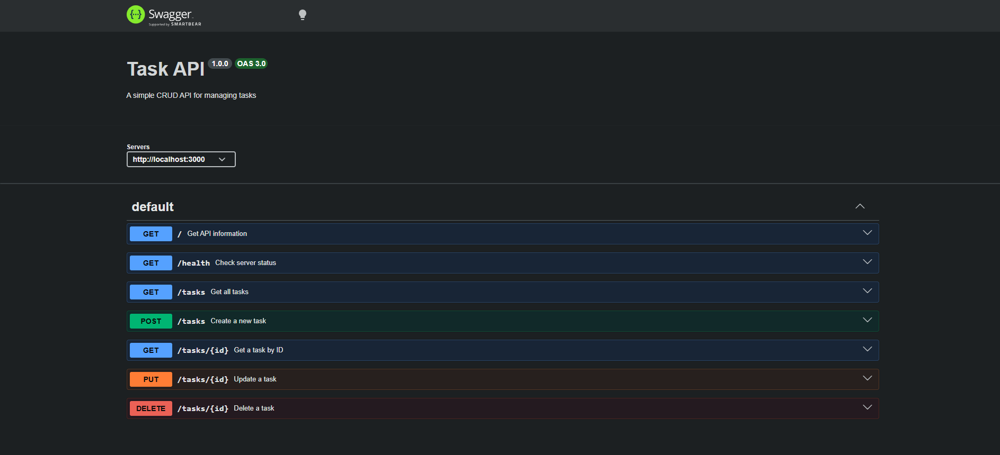

# Task API

This is my first CRUD API project for the FlyRank Backend Internship.

I built it using Node.js and Express. The API manages a simple list of tasks. Users can create, read, update, and delete tasks.

The tasks are stored in memory, so they reset when the server restarts.

## Technologies

- Node.js
- Express.js
- Swagger UI
- Git and GitHub

## How to Run

First, install the dependencies:

```bash
npm install
```

Then start the server:

```bash
node index.js
```

The API runs at http://localhost:3000.

Swagger documentation is available at http://localhost:3000/docs.

## API Endpoints

| Method | Endpoint | Description |
|---|---|---|
| GET | / | Get API information |
| GET | /health | Check server status |
| GET | /tasks | Get all tasks |
| GET | /tasks/:id | Get a task by ID |
| POST | /tasks | Create a new task |
| PUT | /tasks/:id | Update a task |
| DELETE | /tasks/:id | Delete a task |

## Example Request

To get a task, run:

```bash
curl -i http://localhost:3000/tasks/1
```

Example response:

```text
HTTP/1.1 200 OK
Content-Type: application/json; charset=utf-8

{"id":1,"title":"Study JavaScript","done":false}
```

## Status Codes

- 200 - Request successful
- 201 - Task created
- 204 - Task deleted
- 400 - Invalid input
- 404 - Task not found

## Swagger UI

I used Swagger UI to test the CRUD endpoints.



## What I Learned

In this assignment, I learned how to create a server with Express, work with HTTP methods, handle JSON requests, and return the correct status codes.

I also learned how to test APIs using curl and Swagger UI.

One important thing I noticed is that tasks are not saved permanently. When the server restarts, the tasks go back to the original example data because there is no database.
